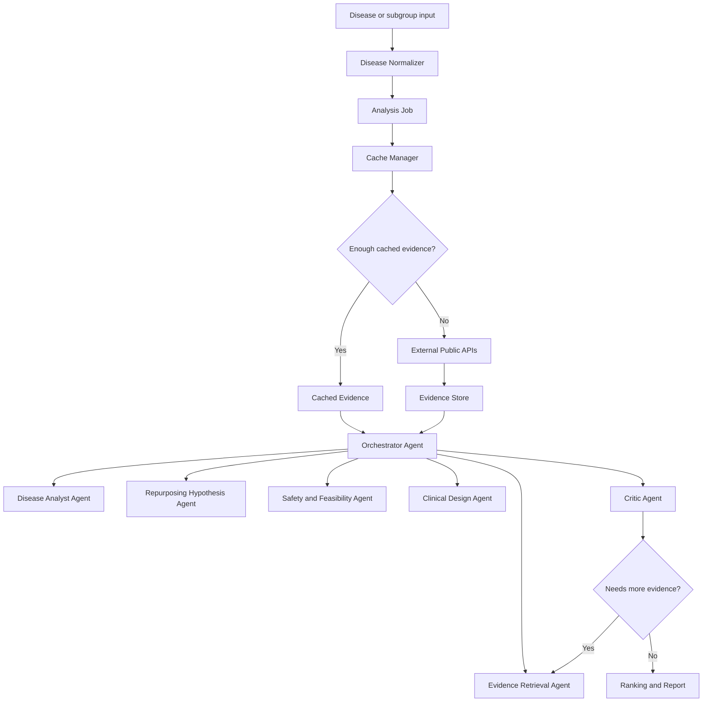

# 메디브릿지 Architecture

## Product Position

메디브릿지는 연구자가 알려진 질환 또는 세부 환자군에 대해 약물 재창출 가설을 만들고 검토할 수 있도록 돕습니다. 자유형 챗봇 답변보다 추적 가능한 근거, 안전성 실현 가능성, 임상 설계 준비도, 명시적인 비판 검토를 우선합니다.

## Agent Layout

The system uses one orchestrator and six specialized sub-agents.

## Main Backend Modules

- `DiseaseNormalizer`: canonical disease name, synonyms, and confidence.
- `CacheManager` / `EvidenceStore`: cache-first evidence lookup.
- `ScoringEngine`: weighted candidate ranking.
- `CitationValidator`: rejects unsupported source references.
- `JobStore`: tracks long-running analysis state.
- `Public API tools`: PubMed, ClinicalTrials.gov, PubChem, ChEMBL, openFDA.

## Why Not Train A Medical Model First

The MVP uses retrieval-augmented generation instead of training a private medical model. This keeps evidence current, reduces training cost, and makes citations inspectable. Fine-tuning or smaller local models can be added later for reranking, disease normalization, or report style consistency.

## Safety Framing

The output is a research hypothesis and early feasibility review. It is not medical advice, diagnosis, prescription guidance, or proof of efficacy.
